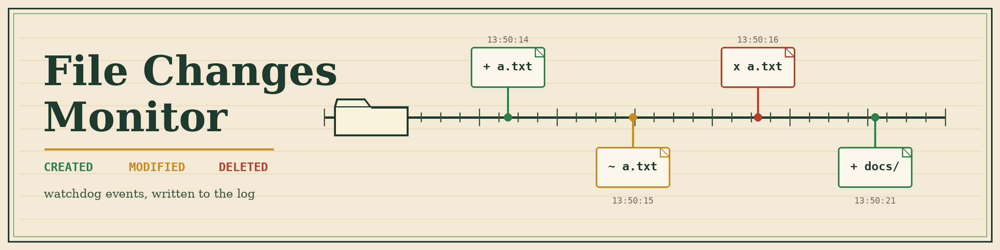

# monitor-filechanges

Monitors one directory for file and directory creation, modification, and deletion using the watchdog library, and logs each event. It runs in the foreground until stopped with Ctrl+C.

## Requirements

- Python 3
- watchdog 3.0.0 or newer (see requirements.txt)
- argparse is part of the Python standard library and needs no installation.

## Install

```bash
git clone https://github.com/ShadowGuardAI/monitor-filechanges.git
cd monitor-filechanges
pip install -r requirements.txt
```

## Usage

```bash
python3 main.py [-h] [--recursive] [--logfile LOGFILE] DIRECTORY
```

- `DIRECTORY` (positional, required): Directory to monitor for file changes.
- `--recursive`: Also monitor subdirectories. Without this flag only the top level of the directory is watched.
- `--logfile LOGFILE`: Also write the log lines to this file. Events are always logged to the console as well.

There are no `-d` or `-l` flags. The directory is a positional argument, and there is no logging level option; logging is fixed at INFO level.

## Example

```bash
python3 main.py /tmp/watchtest --recursive --logfile /tmp/watch.log
```

Example output (timestamps vary):

```text
2026-10-30 13:50:09,402 - INFO - Starting to monitor directory: /tmp/watchtest
2026-10-30 13:50:09,403 - INFO - Recursive monitoring: enabled
2026-10-30 13:50:09,408 - INFO - Monitoring started. Press Ctrl+C to stop.
2026-10-30 13:50:14,094 - INFO - File created: /tmp/watchtest/a.txt
2026-10-30 13:50:15,106 - INFO - File modified: /tmp/watchtest/a.txt
2026-10-30 13:50:16,174 - INFO - File deleted: /tmp/watchtest/a.txt
```

Stop with Ctrl+C, which logs `Stopping monitoring.` and exits.

## Limitations

- If the path does not exist or is not a directory, the program logs an error and exits with status 1.
- Only creation, modification, and deletion events are handled. Move and rename events are not handled separately, and file content is never read.
- Creating a file usually also logs a modification event for the file and a modification event for its parent directory. That is how the underlying filesystem notifications behave.
- There are no bundled tests.

## License

GNU General Public License v3.0. See the LICENSE file in this repository.
